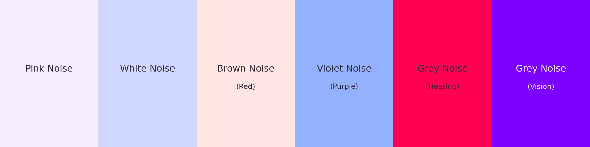

# How pink is pink noise?

Code, source data, and methods for reproducing the colors and figures in the Substack article *How Pink is Pink Noise?* The scripts calculate six optical interpretations of noise spectra and draw the accompanying wavelength, hearing-sensitivity, and vision-sensitivity plots.



| Noise | Power per optical Hz | Power per nanometre | Display color |
| --- | --- | --- | --- |
| Pink | 1/f | 1/λ | `#F5ECFF` |
| White | Constant | 1/λ² | `#D0D7FF` |
| Brown (Brownian / red) | 1/f² | Constant | `#FFE6E2` |
| Violet (purple) | f² | 1/λ⁴ | `#94B1FF` |
| Grey (Hearing) | Mapped hearing compensation | Includes the mapping's change in interval widths | `#FF0052`* |
| Grey (Vision) | Derived from the wavelength model | 1/V(λ) | `#7C00FF`* |

These are optical interpretations over **380–700 nm**, using the CIE 1931 2° observer and direct conversion to sRGB. A common scale factor sets the largest linear RGB channel to 1. There is no white-balance adjustment in the article figures. *Both grey examples fall outside sRGB and are shown with their negative green channel clipped. They are explicitly chosen analogues, not uniquely defined colors of grey noise.*

Brown and violet are the primary names throughout the files. Red is an alias for the Brownian 1/f² model; purple is an alias for violet's f² model.

## Rebuild the figures

Use Python 3.10 or newer. From this folder:

```sh
python3 -m venv .venv
```

Activate the environment with `source .venv/bin/activate` on macOS/Linux, or `.venv\Scripts\Activate.ps1` in Windows PowerShell. Then:

```sh
python -m pip install -r requirements.txt
python build.py
```

This regenerates every figure in `figures/`: the detailed and simplified noise plots, comparison sheets, hearing and vision sensitivity plots, text-free teaser, and labeled reveal. It overwrites the generated outputs.

To also create two downloadable figure archives in a directory of your choice:

```sh
python build.py --archives-dir ../exports
```

All input and output paths are relative to the scripts, so the build also works when called from another directory. No data download is needed. Georgia is used where installed; the bundled Matplotlib DejaVu Serif font is the fallback. Font choice can change lettering, but not the calculated colors.

## What's here

- `generate_noise_figures.py`: the shared color model and six detailed figures; run this first when using the scripts individually.
- `generate_simple_noise_figures.py`: the same six spectra with just a title and labeled axes.
- `generate_sensitivity_figures.py`: vision and hearing sensitivity, reciprocal compensation, and the plotted numerical data.
- `generate_noise_color_reveal.py`: the text-free six-color teaser and labeled answer strip.
- `data/`: the official CIE table and its metadata, plus the ISO 226:2023 parameters used for hearing.
- `figures/`: ready-to-use PNGs, SVGs, and calculated results. The article-friendly versions are in `figures/simple/`; explanatory response plots are in `figures/sensitivity/`.
- [methods.md](methods.md): formulas, normalization, mappings, assumptions, and sources.

## Verification

The build checks the CIE checksum, expected power-law colors, grey compensation results, image dimensions, background pixels, and label bounds. These checks run automatically during figure generation; keep Python assertions enabled when building.

The build was verified with Python 3.12.4, NumPy 1.26.4, SciPy 1.14.0, Matplotlib 3.8.3, and Pillow 10.2.0.

## Sources and attribution

- [CIE (2019), CIE 1931 2° color-matching functions](https://cie.co.at/datatable/cie-1931-colour-matching-functions-2-degree-observer), DOI [10.25039/CIE.DS.xvudnb9b](https://doi.org/10.25039/CIE.DS.xvudnb9b). The data and CIE-derived figures are attributed under [CC BY-SA 4.0](https://creativecommons.org/licenses/by-sa/4.0/); original dataset metadata is included.
- [ISO 226:2023](https://www.iso.org/standard/83117.html), Equation (1) and Table 1, supplies the 60-phon pure-tone contour. Treating this as power per audio Hz and mapping it into light are modeling choices, not ISO prescriptions. Its source and public preview are recorded in `data/iso226_2023_parameters.json`.
- [ICC's sRGB specification](https://registry.color.org/rgb-registry/files/sRGB.pdf) supplies the conversion matrix and encoding.
- [MathWorks colored-noise reference](https://www.mathworks.com/help/dsp/ref/dsp.colorednoise-system-object.html) documents the power-law conventions.

See [methods.md](methods.md) for the complete derivations. The CIE data/figure license does not assign a license to the ISO source or to this project's code.
