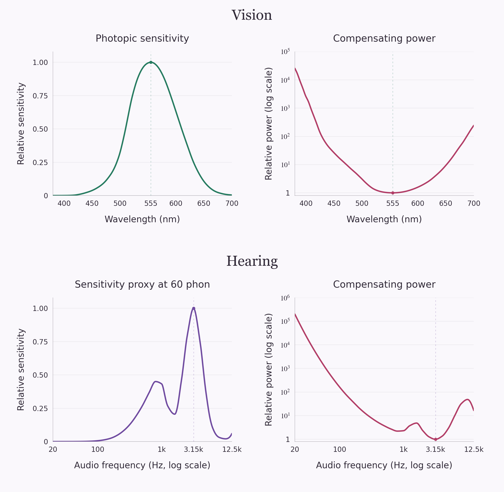
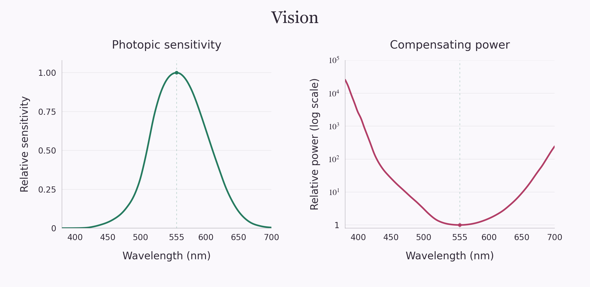
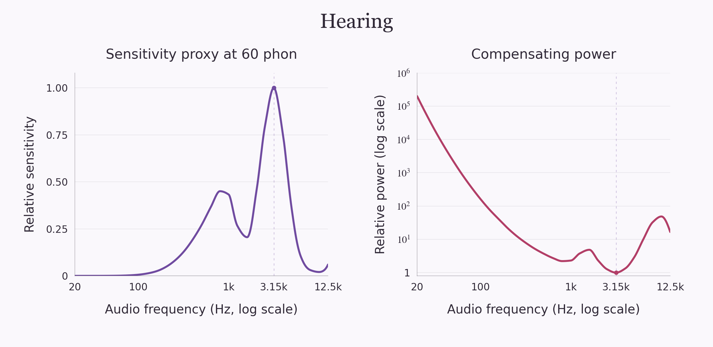

**How we calculated the colors of noise**

Each background is calculated from a specified light spectrum, using the same conversion to display RGB. Pink, white, brown, and violet use conventional noise power laws applied to optical frequencies. The two grey versions are experimental analogues: one compensates for hearing before mapping audio into light, and the other compensates for vision directly. Their colors depend on the choices described here.

| Figure | Spectrum used | Resulting sRGB |
| --- | --- | --- |
| Pink Noise | Power per optical Hz proportional to 1/f | **#F5ECFF** |
| White Noise | Constant power per optical Hz | **#D0D7FF** |
| Brown Noise | Power per optical Hz proportional to 1/f² | **#FFE6E2** |
| Violet Noise | Power per optical Hz proportional to f² | **#94B1FF** |
| Grey Noise (Hearing) | Hearing compensation mapped into light | **#FF0052**, gamut-clipped |
| Grey Noise (Vision) | Equal luminance contribution per nanometre | **#7C00FF**, gamut-clipped |

**The shared color calculation** treats each spectrum as emitted light over **380–700 nm**, with zero contribution outside that interval.

1. Sample radiant power per nanometre at 1 nm intervals, including both endpoints.
2. Multiply the spectrum by the CIE 1931 2° standard observer's three color-matching functions and integrate each product with the trapezoidal rule to obtain CIE XYZ.
3. Convert XYZ directly to linear sRGB. Divide all three channels by the largest channel, setting that channel to 1.
4. Clip the channels to the interval 0–1, apply the standard sRGB encoding, and round to 8-bit RGB. The PNGs contain an sRGB color profile.

The integral in step 2 is

$$
(X,Y,Z)=\int_{380}^{700}S_\lambda(\lambda)\bigl(\bar x(\lambda),\bar y(\lambda),\bar z(\lambda)\bigr)\,d\lambda.
$$

The observer functions come from the [official CIE 1931 color-matching dataset](https://cie.co.at/datatable/cie-1931-colour-matching-functions-2-degree-observer), published at 1 nm resolution. The file's verified MD5 is `17cca777db64b17170f06f67ce9d3ab7`.

The numerical XYZ-to-linear-sRGB matrix used is:

```text
 3.2406255  -1.5372080  -0.4986286
-0.9689307   1.8757561   0.0415175
 0.0557101  -0.2040211   1.0569959
```

After normalization and clipping, each linear channel u is encoded as 12.92u when u ≤ 0.0031308, and as 1.055u^(1/2.4) − 0.055 otherwise. The result is multiplied by 255 and rounded. The matrix and encoding follow the [International Color Consortium's sRGB specification](https://registry.color.org/rgb-registry/files/sRGB.pdf).

There is no additional illuminant multiplied into the emission spectrum and no white-balance adjustment. D65 is the reference white of the sRGB display space. Setting the brightest linear channel to 1 is our brightness convention; it does not make the swatches equal in total radiant power or luminance.

**The four ordinary noise colors** use the conventional power laws below. Here f is optical frequency, and S_f is power per hertz. Pink has equal power in each octave; white has equal power in equal-width frequency intervals. Brown (Brownian, also called red) uses the 1/f² definition, and violet is also called purple noise. [Source: MathWorks colored-noise reference](https://www.mathworks.com/help/dsp/ref/dsp.colorednoise-system-object.html).

Converting from frequency to wavelength requires changing the density as well as the horizontal coordinate:

$$
f=\frac{c}{\lambda},\qquad
S_\lambda(\lambda)=S_f(c/\lambda)\left|\frac{df}{d\lambda}\right|
=S_f(c/\lambda)\frac{c}{\lambda^2}.
$$

The derivative factor preserves power in corresponding intervals. Consequently:

| Noise | Power per Hz | Power per nm in our plots | Display appearance under our convention |
| --- | --- | --- | --- |
| Pink | 1/f | 1/λ | Pale lavender-pink |
| White | Constant | 1/λ² | Pale blue |
| Brown | 1/f² | Constant | Warm near-white |
| Violet | f² | 1/λ⁴ | Periwinkle-blue |

In code, the four spectra are evaluated as (λ/550)^(α−2), with α = 1, 0, 2, and −2 respectively. The 550 nm anchor is an arbitrary common scaling choice; the final brightness normalization removes its effect on the color.

Equal power per optical Hz does not produce the display's D65 white. These results illustrate a particular optical interpretation of the noise definitions; the names alone do not specify unique display colors.

**Why compensate for sensitivity?** Our senses give some parts of a spectrum more weight than others. To give weakly weighted regions a comparable contribution, we allocate more physical power to them, and less to strongly weighted regions. If a response function is R, this construction uses a compensating power proportional to 1/R.

The new figures show that relationship directly. Sensitivity is on the left, normalized so its maximum is 1. Compensating power is on the right, normalized so its minimum is 1. The right-hand vertical axis is logarithmic because the ratios span several orders of magnitude. The dotted guide connects peak sensitivity with minimum required power.

“Dampen” means reduce power relative to other spectral regions here. The absolute output level remains a separate normalization choice. The two senses also require different interpretations: vision uses a standard luminance weighting, while hearing uses a sensitivity proxy derived from one equal-loudness contour.



Suggested combined caption: **More sensitivity, less required power.** Left: the CIE photopic response for vision and an inverse-required-power proxy for hearing at 60 phon. Right: reciprocal power weightings. Sensitivity peaks are scaled to 1; minimum compensation is scaled to 1. Compensation uses logarithmic vertical axes. The hearing plots precede the audio-to-light mapping.

**Grey Noise (Vision)** implements equal photopic luminance contribution per nanometre. Photopic vision describes light-adapted vision. We use the CIE luminous-efficiency function V(λ), represented by y-bar in the CIE 1931 observer data:

$$
S_\lambda(\lambda)\propto\frac{1}{\bar y(\lambda)},\qquad
S_\lambda(\lambda)\bar y(\lambda)=\text{constant}.
$$

The data peak at 555 nm. In our selected interval, the response is 1 at 555 nm, 0.004102 at 700 nm, and 0.000039 at 380 nm. The corresponding power weights are approximately 1, 244, and 25,641. That is why this construction assigns much less power to green and much more to the ends of the interval. [CIE's separate photopic luminous-efficiency dataset documents V(λ)](https://cie.co.at/datatable/cie-spectral-luminous-efficiency-photopic-vision); the calculation itself uses the y-bar column of the observer table already used for all six colors.



Suggested caption: The eye's photopic response peaks near 555 nm. Its reciprocal assigns the least power there and much more near the ends of our 380–700 nm interval, giving equal luminance contribution per nanometre.

Integrating that compensated spectrum produces **#7C00FF** after display clipping. Equal luminance contributions do not imply a neutral mixture, equal cone stimulation, or identical subjective brightness in every context. The choice of equal-width wavelength bins matters: equal contributions per optical hertz would require a different spectrum. The wavelength cutoffs matter especially here because the reciprocal becomes large where sensitivity is small.

**Grey Noise (Hearing)** uses the **60-phon equal-loudness contour from ISO 226:2023**, calculated with Equation (1) and Table 1 at 29 frequencies spanning 20–12,500 Hz. A 60-phon tone is judged as loud as a 1 kHz tone at 60 dB SPL. The standard describes normal hearing in young adults under specified listening conditions. [Source: ISO 226:2023](https://www.iso.org/standard/83117.html).

Let L₆₀(a) be the required sound-pressure level in dB SPL at audio frequency a. The script interpolates those levels with shape-preserving cubic interpolation (PCHIP) against log audio frequency. Our chosen power density is

$$
P_a(a)\propto10^{[L_{60}(a)-60]/10}.
$$

The divisor is 10 because this represents a power ratio, proportional to a squared-pressure ratio. A pressure-amplitude ratio would use 20. Frequencies requiring more sound pressure for the same loudness receive more power in this model.

For the explanatory plots, we define a sensitivity proxy relative to the contour's minimum:

$$
L_{\min}=56.361711999241\ \text{dB SPL at 3150 Hz},
$$

$$
R_H(a)=10^{[L_{\min}-L_{60}(a)]/10},\qquad
C_H(a)=\frac{1}{R_H(a)}=10^{[L_{60}(a)-L_{\min}]/10}.
$$

This puts peak sensitivity at 1 and minimum compensating power at 1, matching the vision plot's presentation. It differs from the original P_a only by a constant scale factor, which disappears in the color normalization. At 20 Hz the required relative power is about 200,000; at 1 kHz it is about 2.31; at 3.15 kHz it is 1.



Suggested caption: At 60 phon, the ISO contour requires the least sound power around 3.15 kHz. The left curve expresses this as an inverse-required-power sensitivity proxy; the right curve gives the compensating power. Both share a logarithmic audio-frequency axis. These curves are shown before converting audio frequencies into wavelengths of light.

This proxy describes a relative power cost at a chosen loudness level. It is not a linear transfer function that predicts arbitrary perceived loudness, and it is not a threshold-of-hearing curve. ISO's contour concerns pure tones; applying it as a per-Hz noise weighting is an illustrative model rather than a complete broadband loudness calculation. [The ISO preview discusses these limitations in its introduction](https://cdn.standards.iteh.ai/samples/83117/6afa5bd94e0e4f32812c28c3b0a7b8ac/ISO-226-2023.pdf).

To turn this audio spectrum into light, we map log audio frequency onto log optical frequency:

$$
a(\lambda)=20\left(\frac{700}{\lambda}\right)^q,\qquad
q=\frac{\ln(12500/20)}{\ln(700/380)}\approx10.53798648,
$$

with λ measured in nanometres. Thus 20 Hz maps to 700 nm and 12.5 kHz maps to 380 nm. Preserving power in corresponding intervals requires

$$
S_\lambda(\lambda)=P_a(a(\lambda))\left|\frac{da}{d\lambda}\right|
=P_a(a(\lambda))\frac{q\,a(\lambda)}{\lambda}.
$$

This final spectrum produces **#FF0052** after display clipping. The extra derivative factor is why the final wavelength graph is not simply the hearing compensation graph with new horizontal labels.

The 60-phon level, audio endpoints, logarithmic mapping, and interpretation as power per audio Hz are our choices. ISO supplies the equal-loudness contour, not an audio-to-color mapping. Choosing a different level, mapping, or bin convention would change the resulting color.

**Display limits and normalization** matter for interpreting the final swatches. Both grey spectra have chromaticities outside sRGB. Before clipping, their normalized linear RGB values are:

| Spectrum | Linear R | Linear G | Linear B |
| --- | --- | --- | --- |
| Grey, hearing | 1 | −0.051677 | 0.084200 |
| Grey, vision | 0.201544 | −0.120659 | 1 |

A display cannot emit negative green, so those channels are set to zero. The grey backgrounds are therefore approximations of the source colors. The four ordinary noise colors require no channel clipping at this normalization.

Each original wavelength-versus-power graph is independently divided by its maximum; its peak is 1. That differs from the new explanatory compensation plots, whose minimum is 1. The spectra have the same shapes. Neither graph scaling changes the calculated background color. The original grey graphs and the new compensation plots use logarithmic vertical axes.

Multiplying an entire spectrum by a positive common scalar changes brightness while preserving chromaticity before clipping. Changing its wavelength limits, spectral weighting, or white-balance treatment can change the color. No arbitrary tint, white mixing, or per-channel color adjustment was added to these six backgrounds.

**Files and reproducibility.** The detailed, simplified, and teaser figures use the same six RGB values. The sensitivity plots explain the compensation used for the two grey analogues. Brown and violet are the main file and figure names; red and purple are retained as aliases where helpful.

- [Color-generation code](generate_noise_figures.py) and [full numerical color results](figures/color-calculations.json).
- [Sensitivity-figure code](generate_sensitivity_figures.py) and [plot reference values](figures/sensitivity/plot-calculations.json).
- [Vision plot data](figures/sensitivity/vision-sensitivity-data.csv) and [hearing plot data](figures/sensitivity/hearing-sensitivity-data.csv).
- [Combined SVG](figures/sensitivity/vision-and-hearing-sensitivity.svg), [vision SVG](figures/sensitivity/vision-sensitivity-compensation.svg), and [hearing SVG](figures/sensitivity/hearing-sensitivity-compensation.svg).

Run `python build.py` from this folder to regenerate all figures, or `python generate_sensitivity_figures.py` for just the sensitivity plots. The latter checks that the explanatory power curves reproduce both grey colors after the appropriate mapping and that the other figure sets remain unchanged. See the [README](README.md) for setup and verification commands.

Data attribution for the post: CIE (2019), *Colour-matching functions of CIE 1931 standard colorimetric observer*, DOI [10.25039/CIE.DS.xvudnb9b](https://doi.org/10.25039/CIE.DS.xvudnb9b), [CC BY-SA 4.0](https://creativecommons.org/licenses/by-sa/4.0/). The CIE-derived figures carry the same license. The hearing model uses ISO 226:2023, Equation (1) and Table 1.
